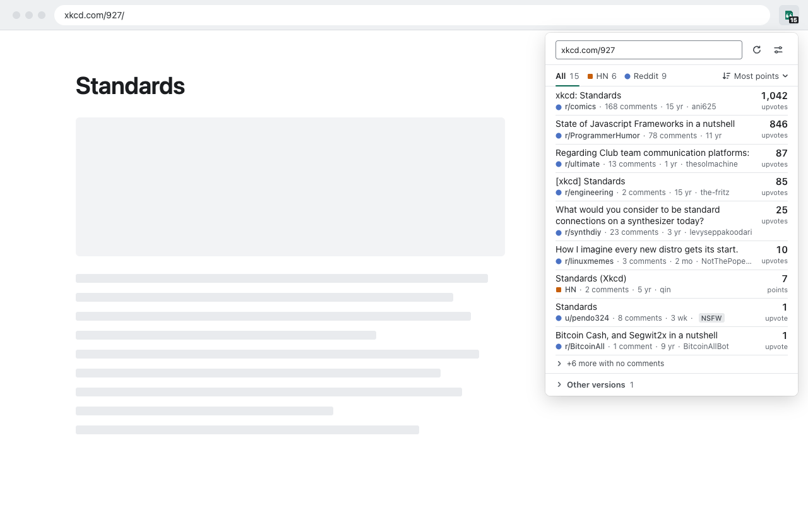

# Find On - Look up current page on Hacker News & Reddit

Find On is a Chrome/Edge extension that shows Hacker News and Reddit discussions of the page you're on. It can look up each page as it loads and show the discussion count on the toolbar badge, or look up pages only when you click the toolbar button.



## Install

- [Chrome Web Store](https://chromewebstore.google.com/detail/dhbjhlhecoimpegffjpmagkhiflkbepe)
- [Microsoft Edge Add-ons](https://microsoftedge.microsoft.com/addons/detail/find-on-reddit-hacker/pokgoanaapnbijafopjbgfbcjhhimknl)

Reddit results need you to be signed in to reddit.com in the same browser profile.

## How matching works

- Before a lookup, Find On cleans the URL. It removes tracking parameters (`utm_*`, `fbclid` and the rest of Brave's and Firefox's lists), parameters that look like secrets (tokens, keys, signatures, session ids) and the `#` fragment. It also unwraps AMP, Wayback Machine, archive.today and redirect links.
- A discussion matches when it links to the same cleaned URL, or to the same content on a site with stable ids: YouTube videos and playlists, arXiv papers (any version), Twitter/X posts, GitHub repos, Medium posts, and Stack Exchange questions.
- Looser matches, such as `m.` or `amp.` hosts, `/amp` paths or extra parameters like `?ref=`, are listed under "Other versions" and don't count toward the badge.
- On a Hacker News or Reddit thread, Find On looks up the page the thread links to and marks the thread you're on.

## Privacy

- There is no Find On server and no analytics.
- To look up a page, Find On sends its cleaned URL to Hacker News search (`hn.algolia.com`, run by Algolia) and to Reddit (`www.reddit.com` and `old.reddit.com`). Hacker News requests carry no cookies.
- Reddit requests carry your reddit.com cookies, which the browser attaches, so Reddit can associate the lookups with your account.
- Automatic lookups are on by default and send the URL of every page you load, except sites on the blocklist (webmail, search and chat sites by default, editable in settings). Manual lookup mode sends a URL only when you click the toolbar button.
- Find On never sends URLs that aren't public web pages: anything other than http and https, localhost, IP addresses, single-label hosts and private names such as `.local` or `.internal`.
- In private windows Find On never looks up pages automatically and sends nothing to Reddit.
- Lookup results stay in memory and are cleared when the browser closes. Settings are kept in the browser's sync storage.

The full policy is in [PRIVACY.md](PRIVACY.md).

## Development

Requires Node 24 (see `.nvmrc`).

```sh
npm ci
npm run dev
```

`npm run dev` builds `.output/chrome-mv3-dev`, rebuilds on change, and does not start a browser. To load it, open `chrome://extensions` (or `edge://extensions`), turn on Developer mode, click "Load unpacked" and pick the folder. Use a profile that is signed in to reddit.com to test Reddit results.

| Command                        | What it does                                                                                                                                         |
| ------------------------------ | ---------------------------------------------------------------------------------------------------------------------------------------------------- |
| `npm run check`                | Format check, lint, typecheck, unit tests and a production build. CI runs these, then the e2e tests.                                                 |
| `npm test`                     | Unit tests only (Vitest).                                                                                                                            |
| `npm run format`               | Formats the code with oxfmt.                                                                                                                         |
| `npm run test:e2e`             | Builds, then runs the Playwright tests in bundled Chromium with a mocked network. Needs `openssl` on the PATH and `npx playwright install chromium`. |
| `npm run zip`                  | Builds and writes `.output/find-on-<version>-chrome.zip`, the package for both stores.                                                               |
| `npm run update-tracking-list` | Regenerates the tracking-parameter list from the upstream Brave and Firefox lists. A weekly workflow runs it and opens a pull request.               |
| `npm run smoke:hn`             | Runs real Hacker News lookups for a few known pages against `hn.algolia.com`.                                                                        |

## Project layout

```text
src/core/         URL cleaning and matching, HN and Reddit providers, lookup, rate guard (no browser APIs)
src/platform/     Browser adapters: settings, cache, badge, automatic lookups, context menu, messaging
src/entrypoints/  Background service worker, popup, options and welcome pages
src/ui/           Shared Preact components and design tokens for those pages
src/assets/       Icon source (SVG)
scripts/          Tracking-list generator and Hacker News smoke test
e2e/              Playwright tests
store/            Store screenshots
```

## Credits

Originally forked from [AdeelH/find-on-reddit](https://github.com/AdeelH/find-on-reddit); v2 is a complete rewrite.

The tracking-parameter list in `src/core/url/tracking-params.generated.json` is generated from Brave's [adblock-lists](https://github.com/brave/adblock-lists) and Firefox's [StripOnShare list](https://github.com/mozilla-firefox/firefox/blob/main/toolkit/components/antitracking/StripOnShareLists/MPL2/StripOnShare.json), and is covered by the [Mozilla Public License 2.0](src/core/url/MPL-2.0.txt). The rest of the project is under the [MIT License](LICENSE).
